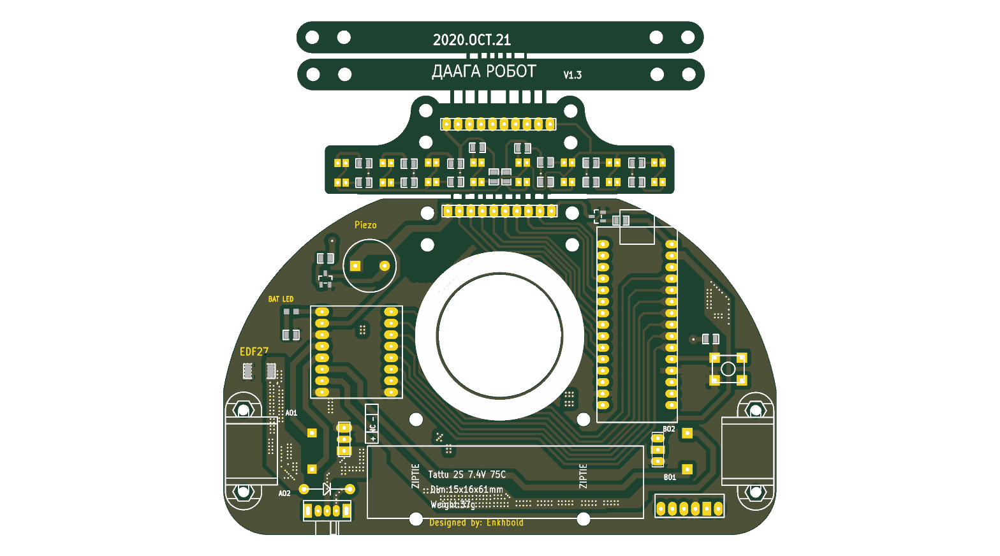

# epro2kicad

**Convert your EasyEDA Pro projects to a KiCad-ready zip — from the command line.**

[](LICENSE)
[](https://www.python.org)
[](https://kicad.org)
[](https://enkhbold470.github.io/epro2kicad/)

> 🌐 **[Try it in your browser →](https://enkhbold470.github.io/epro2kicad/)** —
> drop in a `.epro`, get a repaired KiCad-ready zip back. Nothing is uploaded.
> For fully headless `.kicad_pcb` output, use the command-line tool below.

KiCad ships an excellent native EasyEDA Pro importer — but it's buried in the
GUI. `epro2kicad` drives that same importer headlessly through KiCad's bundled
Python API, so you get GUI-quality conversion in one command. No cloud
uploads, no re-drawing, no dependencies beyond KiCad itself.

```
$ python3 epro2kicad.py MyProject.epro --zip
using KiCad python: /Applications/KiCad/KiCad.app/.../python3
converting PCB a7363ec0... ...
  footprints: 45  tracks: 1068  nets: 63
wrote MyProject_kicad.zip
done: MyProject_kicad/
```

## Example

The [`examples/`](examples/) folder contains a real conversion: the
**Daaga V1.3** sumo-robot board (Arduino Nano + TB6612FNG motor driver +
QRE1113 line sensors), exported from EasyEDA Pro and converted with this tool:



*This render was produced by `kicad-cli pcb render` from the converted
`.kicad_pcb` — every footprint, track, zone and the breakaway sensor panel
survived the round trip.*

## Features

- ✅ **Full PCB conversion** — footprints, tracks, vias, zones, nets, board
  outline, silkscreen, all via KiCad's own EasyEDA Pro parser
- ✅ **Fixes broken exports** — normalizes line endings that crash KiCad's
  importer (`std::out_of_range: map::at` — if you've seen it, this is why)
- ✅ **Fixes new-format exports (EasyEDA 2.2+)** — flattens new-style design
  rules that abort KiCad 8/9 with `type must be number, but is array`
  ([kicad#24303](https://gitlab.com/kicad/code/kicad/-/work_items/24303)) and
  restores the `NET` records newer exports dropped (without them, KiCad 9
  imports every pad and track as `<no net>`)
- ✅ **Multi-PCB projects** — converts every PCB (panels, variants); headless
  KiCad would otherwise abort trying to open a chooser dialog
- ✅ **Web version** — a client-side app
  ([live](https://enkhbold470.github.io/epro2kicad/) · [source](docs/)) that
  repairs and packages `.epro` files in the browser (nothing is uploaded);
  final import is one GUI step in KiCad, since KiCad's C++ importer can't run
  in a browser
- ✅ **KiCad project scaffold** — generates a `.kicad_pro` so the output opens
  as a proper project
- ✅ **Zip output** — `--zip` produces a ready-to-share archive with the
  original `.epro` and instructions included
- ✅ **Zero dependencies** — Python stdlib only; uses the Python bundled with
  your KiCad install

## Install

No install. Just KiCad ≥ 8 ([kicad.org](https://kicad.org)) and this script:

```bash
git clone https://github.com/enkhbold470/epro2kicad.git
cd epro2kicad
python3 epro2kicad.py path/to/YourProject.epro --zip
```

If KiCad's Python isn't auto-detected, point at it explicitly:

```bash
export KICAD_PYTHON="/Applications/KiCad/KiCad.app/Contents/Frameworks/Python.framework/Versions/Current/bin/python3"
```

## Getting your .epro out of EasyEDA Pro

In EasyEDA Pro: **File → Export → EasyEDA Pro (Professional) Project** — that
`.epro` file is what this tool eats.

## Usage

```
python3 epro2kicad.py PROJECT.epro [-o OUTPUT_DIR] [--zip]

  PROJECT.epro   EasyEDA Pro project export
  -o, --output   output directory (default: <name>_kicad/)
  --zip          also produce <name>_kicad.zip
  --version      print version
```

## What about schematics?

KiCad's EasyEDA Pro *schematic* importer is GUI-only (there is no headless
API for it, and no third-party tool supports the Pro format). The output zip
includes your original `.epro` plus instructions — the one manual step is:

> KiCad → **File → Import Non-KiCad Project → EasyEDA (JLCEDA) Pro Project**
> → select the `.epro`

That imports the schematic (and PCB) in about 30 seconds.

## How it works

1. **Normalize** — repacks the `.epro` zip with clean `\n` line endings in
   every JSON Lines document (`.esch`, `.epcb`, `.esym`, `.efoo`). Some
   EasyEDA exports carry CR/LF endings that hard-crash KiCad's parser.
2. **Convert** — invokes KiCad's bundled Python and calls
   `pcbnew.PCB_IO_MGR.Load(EASYEDAPRO, ...)`, then saves with
   `PCB_IO_MGR.Save(KICAD_SEXP, ...)` (not `SaveBoard`, which touches
   project settings and crashes outside a full KiCad session).
3. **Package** — writes a `.kicad_pro`, copies the original `.epro`, adds a
   README, and optionally zips it all.

## Compatibility

| Platform | Status |
|----------|--------|
| macOS (KiCad.app) | ✅ tested (KiCad 10.0.4) |
| Linux (system KiCad) | ✅ should work — pcbnew is on the system Python |
| Windows | ⚠️ untested — set `KICAD_PYTHON` to KiCad's `python.exe` |

## Contributing

Issues and PRs welcome. Ideas that would be great to have:

- Headless schematic conversion (requires upstream KiCad API work)
- Windows testing
- Batch mode for multiple `.epro` files

## License

[MIT](LICENSE) © 2026 Enkhbold Ganbold
